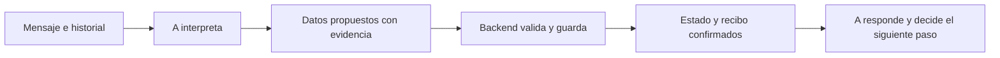

# Auditoría de Ori: interpretación, captura y estado de datos

Fecha: 14 de octubre de 2026. Horarios de Argentina.
Alcance: lectura de producción, pasos durables de Botpress, comparación de
fuente y reproducción local de funciones puras. No se cambió código de la
aplicación, no se publicó otra versión y no se alteraron datos del contacto.

## Conclusión

El fallo específico de autorización del enlace de pago fue corregido y
publicado en `32e109a`, Brain v102. Esa corrección no resolvía toda la captura
de identidad. La conversación de Ori ocurrió después de esa publicación y
sus nueve decisiones identifican v102; no estaba ejecutando el bot anterior.
Esta charla no llegó a pedir un enlace de pago, por lo que no constituye un
canario de pago de la nueva versión.

En Ori hay un problema de arquitectura: A interpreta el diálogo, pero otro
mecanismo decide qué datos puede guardar según patrones de texto y la última
burbuja entregada. El estado que vuelve al agente omite datos parciales. Por
eso A puede reconocer un dato en conversación sin poder convertirlo en un
hecho persistido que autorice la llamada.

No se borraron los mensajes ni faltaba historial: el último contexto de A
contenía tanto «Oriana» como «Di bona». Sin embargo, el contacto conservaba
`name=null` y A recibía nombre y apellido como faltantes. El fallo final de
interpretación de «Di bona» es real; la inconsistencia de datos es una causa
comprobada del ciclo, aunque no permite atribuir cada palabra del modelo a
una única causa.

## Lo ocurrido

Conversación `025fda21-85bd-4ffd-a9cd-1b0d4c43b6c2`, número terminado en 9490.
Se recuperaron los nueve workflows y sus propuestas originales.

| Hora | Evidencia | Consecuencia |
| --- | --- | --- |
| 11:01 | A seleccionó correctamente Fotografía Profesional. Envió explicación, pregunta de nombre y oferta de llamada en tres burbujas. | La selección de curso funcionó. |
| 11:03:31 | La usuaria respondió «Oriana». A la interpretó como `provide_contact_details` y la saludó por ese nombre. | No hubo recibo de captura de nombre y `contacts.name` siguió vacío. |
| 11:03:36 | Respondió «Si dale». El estado conservó aceptación de llamada. | A pidió apellido y correo; no existía todavía identidad operativa completa. |
| 11:04:35 | Respondió «Di bona». La ingesta registró `surname="Di Bona"`, `first_name=null` en el mensaje. | El dato parcial no fue proyectado al contexto. A volvió a pedir apellido y correo. |
| 11:04:46 | Envió su correo. | El correo sí se persistió. El contexto seguía marcando nombre y apellido faltantes. |
| 11:05:55 | Escribió «Acá está». El capturador lo registró como `surname="Acá Está"`. | Demuestra que el reconocedor sintáctico también puede aceptar una referencia como identidad. |
| 11:06:21 | Repitió «Di bona». La ingesta volvió a guardar ese apellido parcial. | A respondió «no te entendí bien» y siguió pidiendo apellido; su propuesta fue `unknown`. |

Estado final: correo disponible, teléfono real del canal disponible, nombre
completo vacío, consentimiento de llamada aceptado, cero sesiones de llamada.
El contexto canónico marcaba `nombre` y `apellido` faltantes. No hubo despacho
a Xendra en esta prueba: no es un rechazo del proveedor.

La primera respuesta a «Oriana» fue reemplazada porque llegó «Si dale» mientras
se procesaba (`SUPERSEDED_BY_NEWER_INBOUND`). El turno siguiente conservaba
«Oriana» en el historial y la saludó por su nombre. Esa sustitución explica
una respuesta no entregada, pero no la pérdida inicial de captura, que ya
había ocurrido durante la ingesta.

## Causas comprobadas

### 1. La unidad de captura es la última burbuja, no la pregunta pendiente

La entrega real fue:

1. Explicación del curso: 11:01:11.709.
2. «Cómo te llamas?»: 11:01:13.812.
3. Oferta de llamada: 11:01:16.244.

`captureDeliveredContactIntakeResponse` ordena las entregas y hace `LIMIT 1`.
Después busca campos solicitados solamente en ese mensaje. Eligió la oferta
de llamada, que no pide nombre, y devolvió captura nula. La pregunta válida
de la burbuja anterior sí había llegado al mismo contacto.

Un nombre suelto no entra en la captura explícita de presentación. «Oriana»
se acepta si se vincula a la pregunta de nombre, pero no contra la oferta.
La identidad queda dependiendo del orden de burbujas y de cómo A redacte.

### 2. Los datos parciales se guardan en un lugar que el contexto no lee

El apellido sin primer nombre se conserva en
`messages.metadata.contact_name_answer_v1`. El capturador devuelve
`name=null` cuando todavía no puede formar el nombre completo.

`loadContactIntakeV1` consulta sólo `contacts.name`, correo y teléfonos;
no incorpora ese apellido parcial. El backend registró «Di Bona», pero el
siguiente contexto informó `apellido=null`. No es un fallo de escritura SQL:
es una desconexión entre la representación parcial y la fuente canónica.

### 3. A reconoce datos, pero no tiene un contrato para persistirlos

La propuesta permite un movimiento `provide_contact_details`, mensajes,
memorias generales y teléfono confirmado. No tiene actualizaciones tipadas
de primer nombre y apellido con referencia al mensaje que los aportó.

Saludar «Oriana» no escribe `nombre=Oriana`. Declarar que se recibieron datos
tampoco los guarda. A y la ingesta mantienen interpretaciones independientes
que pueden discrepar; luego A mezcla el historial entendido con faltantes
calculados desde un estado incompleto.

### 4. La captura sintáctica no equivale a entender qué está contestando

«Acá está» pasó como apellido. Añadir esa frase a una lista de exclusiones
dejaría intacto el mismo problema para otras referencias, confirmaciones o
mensajes que mezclen datos y preguntas. Tampoco basta con admitir «Di Bona»
en otra expresión regular.

Las decisiones posteriores se registraron sin errores técnicos y los
workflows finalizaron. Eso prueba ejecución, no progreso de recolección ni
corrección semántica. A pidió correo para preparar la llamada aunque su
requisito operativo es nombre, apellido y teléfono; el diseño debe exponer
faltantes por operación y no confundirlos con datos útiles para un pago futuro.

## Comparación con lo anterior y alcance de las pruebas

En `b742e30`, del 1 de octubre a las 19:52 Argentina, ya existen la selección
de la última burbuja y el apellido parcial con `name=null`. Se reprodujeron
esos dos resultados con las funciones de ese commit. El lector de intake no
tiene diferencias entre ese commit y la fuente publicada actual.

`232611a` corrigió otra pérdida: conservar una respuesta de varios mensajes
asociada a una misma pregunta de datos. No sustituyó la elección de la última
burbuja ni la representación de datos parciales. Esos tres archivos de
captura/proyección no cambiaron entre `232611a` y `32e109a`.

Las pruebas anteriores cubrían presentaciones explícitas y una solicitud de
datos elegible antes de los fragmentos. No cubrían nombre suelto contestando
una pregunta que dejó de ser la última burbuja, ni la coherencia entre un
apellido parcial y el contexto que recibe A. Por eso aprobar esos recorridos
no demostraba una solución general de captura. No hay evidencia aquí de que
el merge haya eliminado una solución completa previamente existente.

## Propuesta de arquitectura: una interpretación y un estado de datos

La interpretación semántica debe pertenecer a A. El backend debe validar
procedencia, formato, versión y permisos, persistir y devolver hechos. No debe
deducir identidad desde la redacción que A decidió usar.

1. **Campos independientes y canónicos.** Guardar nombre, apellido, correo y
   teléfono por separado, aunque todavía falten otros. Cada campo conserva
   valor, estado, mensaje de origen y versión. El nombre completo es una
   proyección para interfaces y sistemas que lo requieran. Un apellido no
   depende de que exista el nombre; un nombre compuesto no se divide por
   posición para inventar un apellido.
2. **Actualizaciones propuestas por A.** Su contrato debe expresar qué campo
   aporta o corrige el usuario, su valor y la evidencia vinculada a mensajes
   reales. Una referencia como «acá está» puede enlazar a un dato previo, no
   convertirse automáticamente en un apellido. Ante ambigüedad, A solicita
   aclaración. La misma generación interpreta y conversa; no hace falta otro
   modelo competidor para extraer datos.
3. **Preguntas pendientes estructuradas.** Registrar qué campos se solicitaron
   y qué pregunta fue efectivamente entregada. Esa expectativa pertenece al
   diálogo y no desaparece por enviar otra burbuja de curso o de llamada.
   A puede resolver varias respuestas en mensajes separados y cerrar cada
   campo cuando se confirma, sin imponer frases ni una secuencia rígida.
4. **Validación y persistencia antes de confirmar.** El backend comprueba que
   la evidencia pertenece al contacto/conversación, aplica formato y control
   de versión, guarda los campos válidos y devuelve un recibo estructurado.
   La siguiente autorización y el contexto de A usan ese mismo estado. Un
   rechazo de llamada o una reparación de texto no deshacen datos válidos.
   Una respuesta reemplazada por otra más nueva no debe borrar observaciones
   válidas del usuario ni sobrescribir una corrección más reciente.
5. **Faltantes por operación y continuidad.** Mantener la intención pendiente
   y su consentimiento. Para llamar se evalúan los requisitos de llamada;
   para pagar, los de pago. A decide cómo solicitar lo que realmente falta y
   cuándo retomar la operación. Completar datos por sí solo no autoriza una
   llamada, un cobro o el envío de un enlace que nadie pidió.
6. **Coherencia verificable.** Evaluar datos entendidos, campos confirmados y
   preguntas pendientes juntos. Si el backend rechazó un dato, A recibe el
   motivo y conserva la evidencia para aclararlo. No se reparan contradicciones
   reescribiendo la respuesta desde el orquestador. Medir repetición de campos
   ya aportados y falta de avance, además de errores HTTP y de esquema.

La garantía buscada es que lo interpretado, lo validado y lo expuesto como
conocido coincidan. Esto preserva la voz y naturalidad de A: cambia su capacidad
de actuar sobre datos, no le agrega respuestas protocolares.

La propuesta elimina estas desconexiones; no garantiza que el modelo entienda
cualquier texto. Por eso necesita estados de ambigüedad y aclaración, evidencia
auditable y evaluación real de interpretación, además de pruebas de persistencia.

## Cómo comprobar una solución general

Validar la migración con nombres no usados durante implementación; nombres
y apellidos compuestos; distintas mayúsculas, idiomas y formatos; respuestas
mixtas; referencias a mensajes previos; cambios y retractaciones; contactos
de terceros; mensajes partidos o reordenados; múltiples preguntas y burbujas;
respuestas reemplazadas; reintentos y concurrencia.

Las aserciones deben comprobar el estado canónico, la evidencia y el siguiente
contexto, además de la respuesta visible. Un dato confirmado no se vuelve a
pedir; un dato incierto no se inventa; una corrección vieja no pisa la nueva;
una operación válida pendiente se puede retomar una sola vez. Completar con
pruebas controladas del modelo real, porque fixtures de propuestas correctas
no verifican su interpretación de todas esas variantes.

La migración debe unificar la fuente de verdad y retirar la captura semántica
legacy. No conviene promover indiscriminadamente sus recibos parciales: esta
auditoría demuestra que alguno contiene «Acá Está» como apellido. Los datos
ambiguos requieren reconciliación con evidencia y, cuando corresponda,
confirmación del usuario. La propuesta no está implementada.

## Referencias de fuente y evidencia

- `src/lib/services/ingestion.service.ts:268`: elección de burbuja y captura.
- `src/lib/heuristics/contact-identity.ts:390`: apellido parcial/nombre nulo.
- `src/lib/repositories/contact-intake.repository.ts:26`: lector canónico.
- `botpress-agent/src/schemas/agent-a-brain.ts:215`: contrato actual de A.
- `botpress-agent/src/lib/conversation/agent-a-context.ts:573`: datos canónicos
  reenviados al modelo.
- Evidencia privada: `tmp/ori-20261014-evidence-*.json`,
  `tmp/ori-workflow-states-20261014.json`,
  `tmp/ori-delivery-evidence-20261014.json`, en el workspace padre.
- Producción comprobada a las 11:41: backend health 200 con `32e109a`, bot
  publicado a las 10:49:53, plannerless activo, modelo e identidad conservados.
